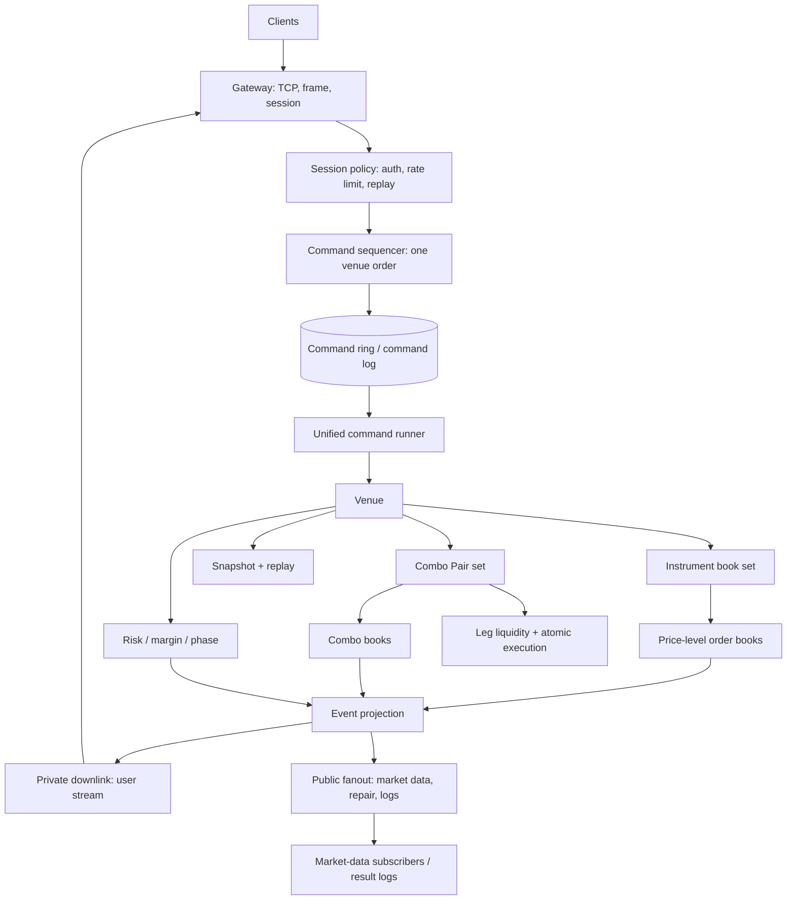

# System architecture baseline

Status: design baseline. This document describes the target structure and the
gap from the current feature-accreted code. It is not a claim that the current
tree already has these boundaries.

## Verdict

The codebase is not bloated primarily because of line count. It is incoherent
because the same domain concepts have several parallel representations:

- orders: `OrderNode`, `OrderMeta`, `RestingOrder`, `ComboOrder`, `AuctionOrder`
- books: dense `LevelQueue` array in the core, `BTreeMap<i64, VecDeque<ComboOrder>>`
  in the combo book
- events: `CoreEvent`, `ComboEvent`, `PublicEvent`, `PrivateEvent`,
  `ComboFill`/`ImpliedComboFill`/`ComboPrivateFill`, `PrivateEffect`, gateway
  frames, result-log slots
- runners: `CoreRunner` and `RegistryRunner` project the same effects twice
- snapshots: `CoreSnapshot`, `RegistrySnapshot`, `ComboBookSnapshot`,
  `ComboMarginSnapshot`, `PrivateDownlinkSnapshot`, `TradingSnapshot`

That is why the code feels copied: each feature added a local model instead of
extending one venue model.

## Target layers



Control plane: session/auth/rate/phase/schedule.
Data plane: command ring -> venue -> event projection -> gateway/market data.
Recovery plane: command log + snapshot -> deterministic replay.

## Current-to-target boundary

| Current | Target | Why |
|---|---|---|
| `InstrumentRegistry` owns venue, books, combo, margin, snapshot, projection | `Venue` owns lifecycle; `MatchingEngine` owns matching; `EventProjector` owns output | one reason per module |
| `TradingCore` (2.2k lines) owns kernel, orders, positions, snapshots, events | `InstrumentMatching` + `OrderBook` + `RiskState` + `CoreSnapshot` | separate state machines |
| `CoreRunner` and `RegistryRunner` both poll/project | one `VenueRunner` over a `CommandTarget` | one command path |
| dense array core book, BTreeMap combo book | one generic `PriceLevelBook` with pluggable level storage and order slab | one order lifecycle |
| many event structs | one canonical envelope per stream (`PrivateEffect`, `PublicEvent`); internal matching events stay internal | independent sequence domains |
| six snapshot structs/versions | one `SnapshotEnvelope` with registered schema versions | recovery is a first-class plane |
| primitive ids (`u64`, `u32`) everywhere | newtypes for instrument/account/session/order/pair/sequence | compile-time domain safety |

## Canonical domain model

```text
Venue
  phase, trading_day, sequence domains
  instruments: InstrumentId -> InstrumentMatching
  pairs:       ComboPairId -> ComboPair
  risk:        account -> positions/margin
  snapshot/replay

InstrumentMatching
  instrument, order book, active orders, positions, frozen close
  matching kernel (pure, deterministic)

PriceLevelBook
  level storage (dense or sparse strategy)
  order slab + intrusive FIFO per level
  best-price bitmap
  snapshot/restore

Order (common)
  exchange_id, client_id, account, session, instrument
  side, qty, remaining, price, offset, hedge
  state: accepted | resting | partially_filled | filled | canceled | rejected
  kind: limit | market | advanced_market | combo | auction

PrivateEffect
  canonical private delivery envelope (core + combo)
PublicEvent
  canonical public delivery envelope (core + combo trade)
CoreEvent / ComboEvent
  internal matching results, projected by the runtime
```

`ComboOrder` remains a different aggregate (two legs, pair, spread), but it
must share order identity, state transitions, and event metadata with ordinary
orders. It should not have a second lifecycle implementation.

## Exchange-grade concerns

These are not optional for a futures exchange trading system. The architecture
must make each one a named component, not an implicit behavior:

```text
deterministic single-writer matching per instrument
one venue sequence per stream (private user, public market data, command)
session/phase/schedule control plane
price limits, position limits, self-trade prevention, risk checks
combo atomicity and implied execution
order/command audit log, replay, snapshot
market data publication + gap repair
failure domain and restart/recovery runbook
```

Current code covers several of these, but they are spread across modules. The
target makes ownership explicit.

## Migration order

Do not rewrite in one pass. The order below preserves behavior and benchmarks
at every step:

1. **Domain newtypes + per-stream event truth**  
   Introduce ids/sequences; keep `PrivateEffect`/`PublicEvent` as the canonical
   envelopes. Internal `CoreEvent`/`ComboEvent` projects into them. See ADR-0004.

2. **Shared order lifecycle, not shared storage**  
   Unify order identity/state and atomic execution semantics. Keep the core
   dense array and the combo sparse ladder (ADR-0005).

3. **One runner**  
   Collapse `CoreRunner` and `RegistryRunner` into a `VenueRunner` over a
   command target. Split deployment becomes a target implementation, not a
   second runner.

4. **Venue split**  
   Move ownership out of `InstrumentRegistry` into `Venue`, `ComboVenue`,
   `RiskState`, `EventProjector`; registry becomes a thin façade or disappears.

5. **Snapshot envelope**  
   Register one schema/version table; migrate `CoreSnapshot`, `RegistrySnapshot`
   and private seq into one envelope.

## Design tests

- Adding a new order type touches one order model and one matching dispatch,
  not every representation.
- Adding a new event touches one envelope and one projection, not five structs.
- A snapshot version change is registered once and tested once.
- Split versus single-process changes the composition root, not the runner or
  matching logic.
- Combo and ordinary orders share order identity/state, while combo keeps only
  its two-leg execution rules.

## Immediate next

Create one architecture consolidation ticket with the migration order above.
Do not do more local micro-optimizations until the event/order model is unified.
